# ДЗ 1

## Задача 1. Ручной счёт.

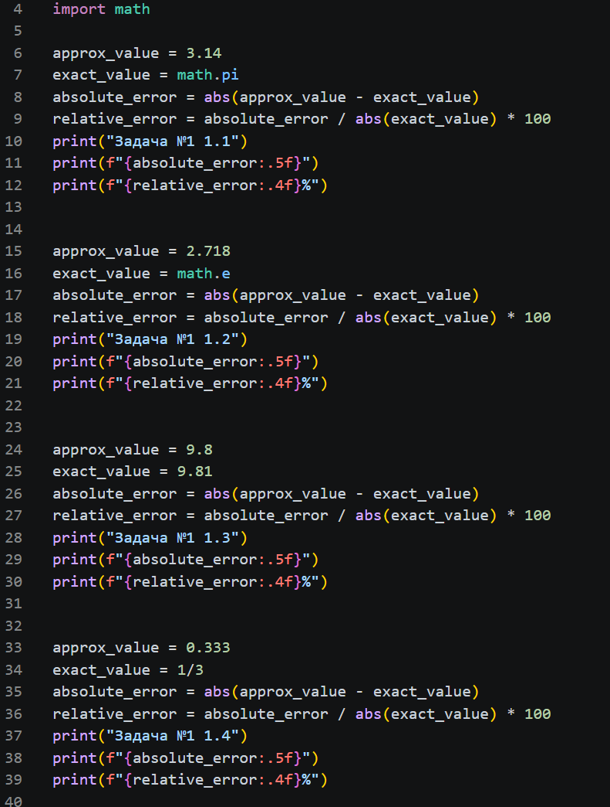

**Вывод:**

0.00028 (2) --> 0.00033 (4) --> 0.00159 (1) --> 0.01000 (3)  
абсолютная погрешность от самого точного к самому неточному: 2, 4, 1, 3

0.0104% (2) --> 0.0507% (1) -->  0.1000% (4) --> 0.1019% (3)  
относительная погрешность от самого точного к самому неточному: 2, 1, 4, 3

Порядки не совпадают, потому что абсолютная погрешность показывает, насколько мы ошиблись, а относительная - насколько эта ошибка велика по сравнению с самим числом. Поэтому одна и та же ошибка для маленького числа будет более значительной, чем для большого.

## Задача 2. Сравнение несопоставимых величин.

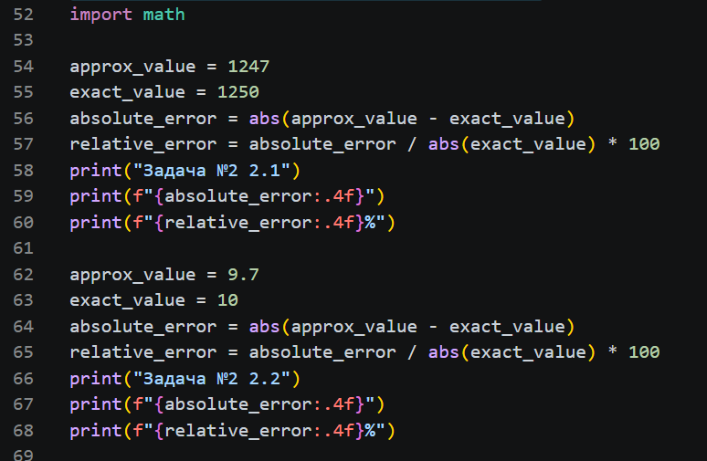

**Вывод:**

По абсолютной погрешности сильнее ошиблись при измерении моста: 3 м = 3000 мм, а у болта погрешность 0.3 мм. По относительной погрешности сильнее ошиблись при измерении болта: 3% у болта и 0.24% у моста. Относительная погрешность учитывает, насколько ошибка велика по сравнению с самой измеряемой величиной.

## Задача 3. Функция relative_error.

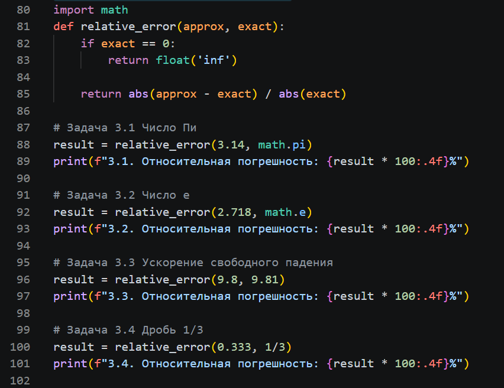

**Вывод:**

Для всех четырёх пар получились те же значения, что и в задаче 1. Если точное значение равно нулю, функция возвращает inf.

## Задача 4. Обратная задача - оценка точного значения.

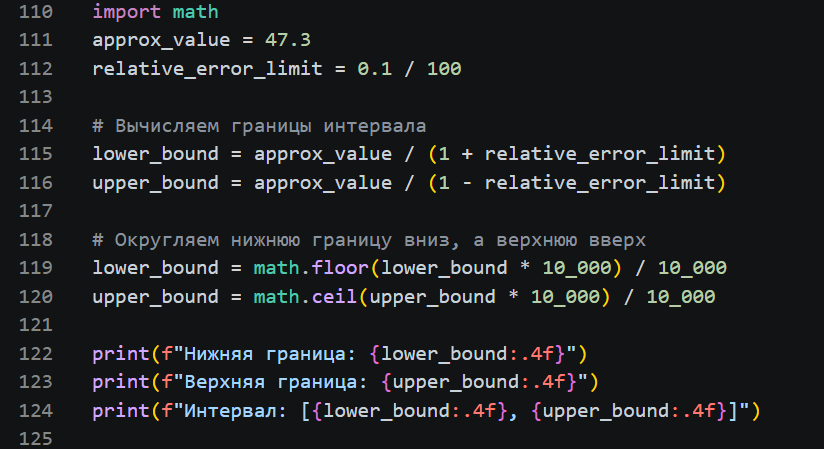

**Вывод:**

Границы получились из неравенства `|47.3 - x*| <= 0.001 * |x*|`. После округления точное значение лежит в интервале [47.2527, 47.3474].

## Задача 5. Порог по абсолютной и относительной ошибке.

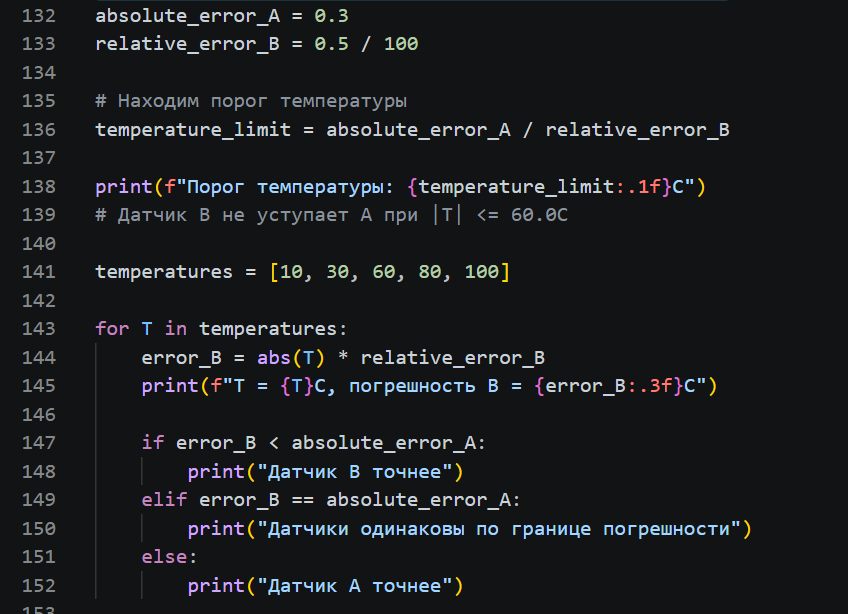

**Вывод:**

При `-60 <= T <= 60C` погрешность датчика B не превышает 0.3C. При `|T| < 60C` датчик B имеет меньшую границу погрешности. При `|T| = 60C` границы погрешности одинаковы. При `|T| > 60C` датчик A имеет меньшую границу погрешности. Выбор датчика зависит от диапазона температур, поскольку абсолютная погрешность B растёт с увеличением `|T|`.

## Задача 6. Подсчёт значащих цифр

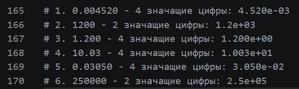

**Вывод:**

Числа 1200 и 250000 имеют неоднозначное количество значащих цифр, поскольку неизвестно, являются ли конечные нули значащими. Для чисел 1200 и 250000 мы приняли 2 значащие цифры. Экспоненциальная форма позволяет однозначно указать количество значащих цифр.

## Задача 7. Честная запись результата

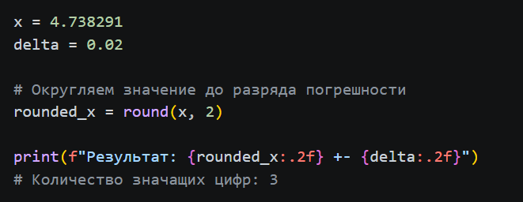

**Вывод:**

Результат измерения: 4.74 +- 0.02. После округления осталось 3 значащие цифры. Запись 4.738291 +- 0.02 некорректна, поскольку содержит лишние цифры, не соответствующие точности измерения.

## Задача 8. Округление и banker's rounding

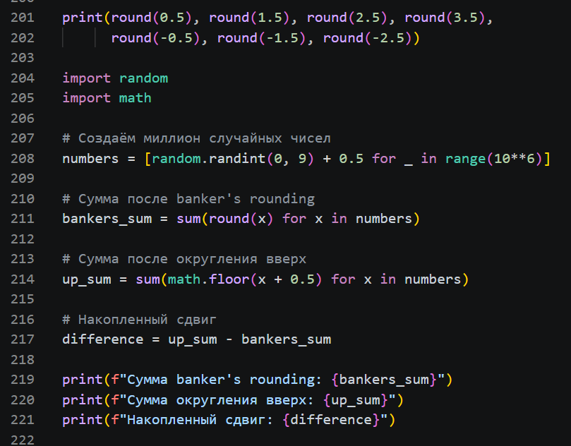

**Вывод:**

Python при точном значении .5 округляет к ближайшему чётному целому числу. При округлении половин всегда вверх возникает систематическое завышение суммы. Для миллиона чисел ожидаемый сдвиг составляет 500000. В финансовых расчётах это важно, поскольку ошибки округления могут накапливаться при большом числе операций.

## Задача 9. Промежуточное округление

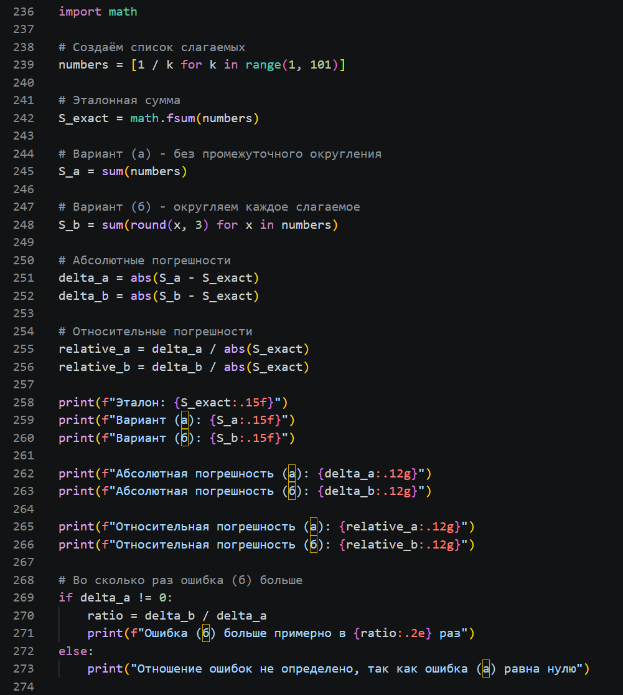

**Вывод:**

Промежуточное округление увеличивает погрешность, так как ошибки накапливаются при суммировании. Правило: округлять следует только конечный результат, сохраняя максимальную точность промежуточных вычислений. На Python 3.14.7 сумма без промежуточного округления совпала с math.fsum(), поэтому отношение ошибок не определено.

## Задача 10. Классика 0.1 + 0.2

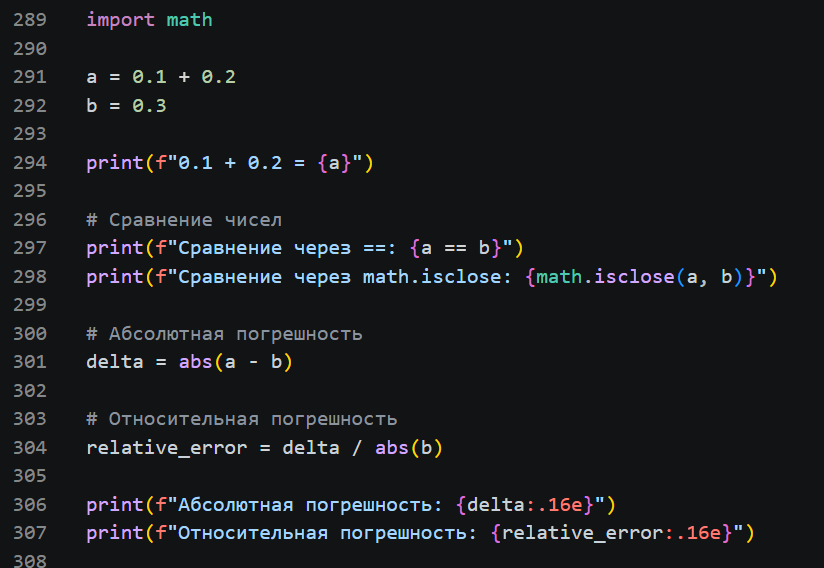

**Вывод:**

Компьютер хранит дробные числа в двоичной системе, и число 0.1 невозможно записать в ней точно конечным числом цифр. Поэтому компьютер сохраняет ближайшее доступное значение. При сложении таких чисел возникают небольшие погрешности, из-за которых 0.1 + 0.2 не равно точно 0.3.

## Задача 11. Катастрофическая потеря точности

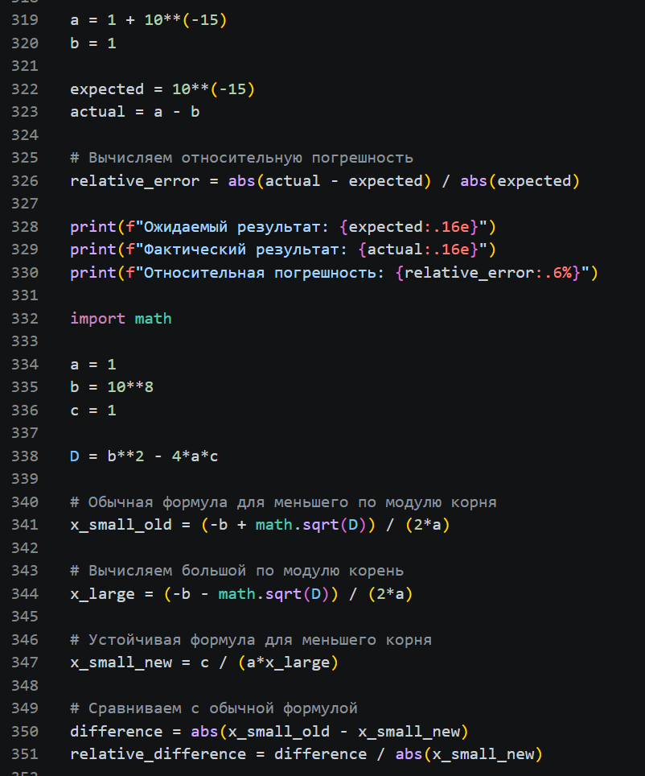

**Вывод:**

При вычитании близких чисел возникает потеря точности из-за ошибок округления при работе с float. В первом эксперименте относительная погрешность составила примерно 11.02%. При решении квадратного уравнения обычная формула даёт заметную ошибку для меньшего по модулю корня. Использование формулы Виета позволяет избежать вычитания близких чисел и повысить точность вычислений. Для меньшего по модулю корня ошибка уменьшилась примерно в 3.22e15 раз.

## Задача 12. Накопление ошибки в цикле

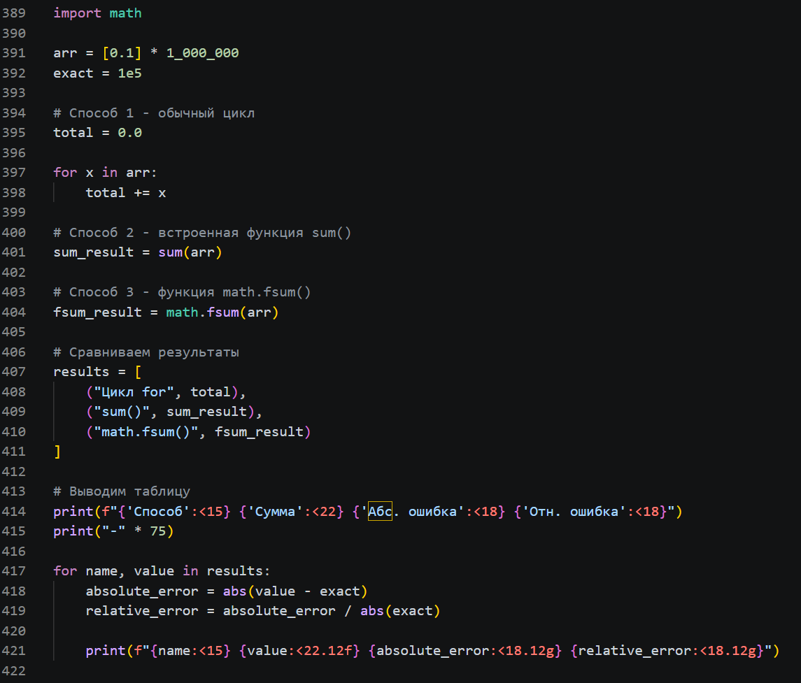

**Вывод:**

При сложении миллиона чисел 0.1 обычным циклом накапливается погрешность из-за ограниченной точности float. На Python 3.14.7 sum() и math.fsum() получили результат без погрешности относительно эталона 100000. Поэтому определить, во сколько раз они точнее, через деление погрешностей невозможно. Для более точного суммирования рекомендуется math.fsum().

## Задача 13. Суммирование в правильном порядке

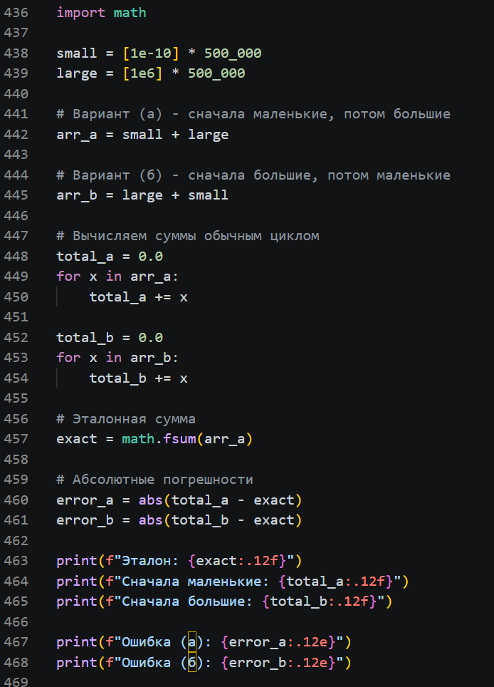

**Вывод:**

Порядок суммирования влияет на точность вычислений. При сложении сначала маленьких чисел погрешность относительно math.fsum() оказалась равна нулю. При сложении сначала больших чисел погрешность составила примерно 6.1e-05. Маленькие числа могут теряться при прибавлении к большой сумме из-за ограниченной точности float. Поэтому при обычном суммировании лучше начинать с меньших по модулю чисел.

## Задача 14. Детектор накопления погрешности

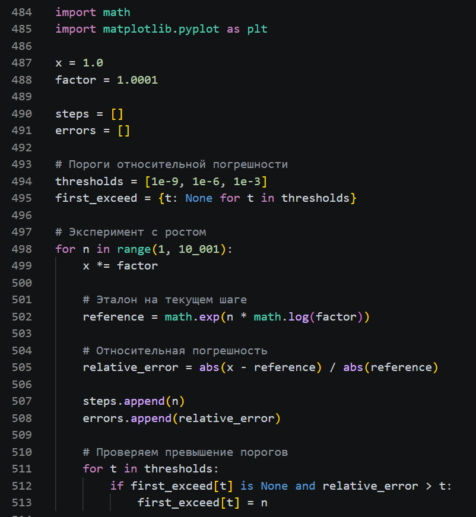

**Вывод:**

При многократном умножении накапливаются ошибки округления. За 10000 шагов относительная погрешность достигла примерно 1e-14, но не превысила пороги 1e-9, 1e-6 и 1e-3. График показывает, что погрешность растёт неравномерно, иногда увеличиваясь, а иногда уменьшаясь. В данном эксперименте накопление ошибки происходит медленно, однако в других мультипликативных процессах погрешность может расти быстрее.

## Задача 15. Финансы: float vs Decimal

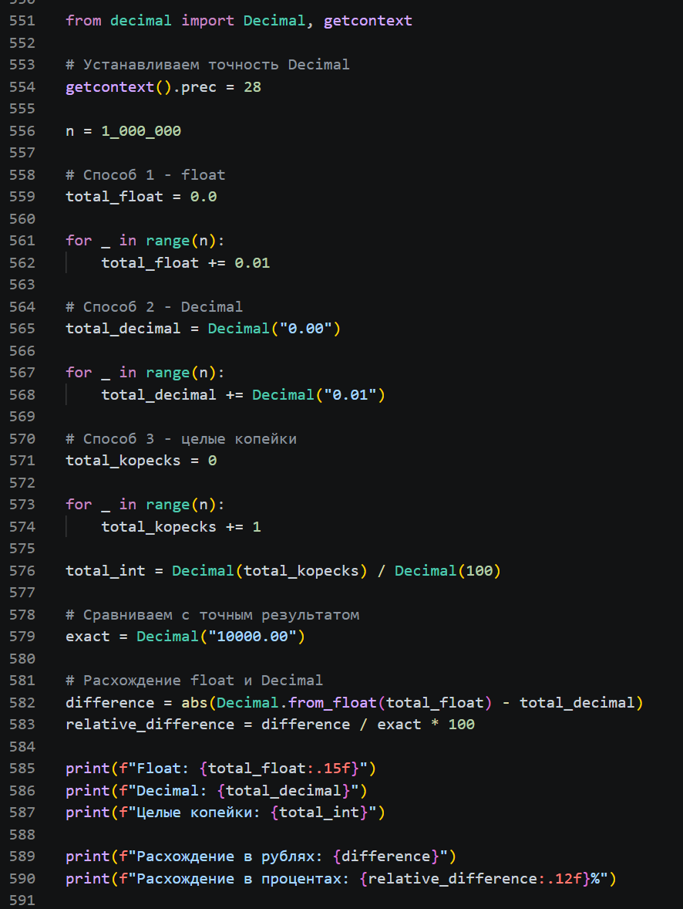

**Вывод:**

При миллионе начислений по 0.01 рубля float накопил небольшую погрешность. Расхождение составило примерно 1.72e-7 рубля, или 0.000000001719%. Decimal и int получили точный результат 10000 рублей. В финансовых расчётах лучше использовать Decimal или целые копейки, поскольку float не может точно представлять многие десятичные дроби.
